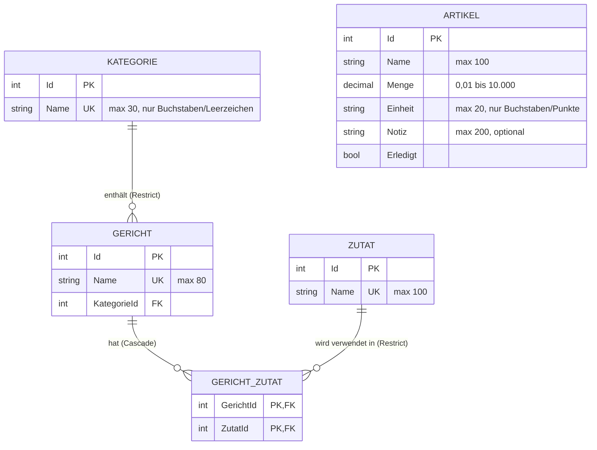

# Dokumentation: Datenbank-Implementierung Einkaufsliste

Blazor Server (.NET 8) mit Entity Framework Core (Code First) und SQLite.

## ER-Diagramm (tatsächlich umgesetztes Modell)



`GERICHT` und `ZUTAT` bilden die **n:m-Beziehung** über die Verbindungstabelle `GERICHT_ZUTAT`.
`ARTIKEL` ist die eigentliche Einkaufsliste. Der Name ist bewusst Freitext, weil man auch Dinge einkauft,
die weder Gericht noch Zutat sind (z. B. „Brot“). Eine Eindeutigkeit gilt für (`Name`, `Einheit`), siehe unten.

## Wichtige Entscheidungen und Abweichungen

| Entscheidung | Begründung |
|---|---|
| **Zutaten als eigene Entität** statt `List<string>` im Gericht (Abweichung vom alten Modell) | Nur so ist eine n:m-Beziehung möglich. „Milch“ wird einmal gespeichert und von mehreren Gerichten verwendet. |
| **Kategorie als eigene Entität** (1:n zu Gericht) | Kategorien wie „Dessert“ wiederholen sich. Tippfehler wie „Dessert“ / „Desert“ werden so vermieden. |
| **Löschverhalten:** Gericht löschen → Zuordnungen `Cascade`; Kategorie und Zutat mit Verwendung → `Restrict` | Ein Gericht gehört dem Benutzer, seine Zuordnungen haben ohne Gericht keinen Sinn. Kategorien und Zutaten werden von anderen Gerichten mitverwendet und dürfen nicht stillschweigend verschwinden. |
| **Zusammengesetzter Primärschlüssel** (`GerichtId`, `ZutatId`) | Ersetzt die frühere Duplikatprüfung `KeineDoppeltenZutaten`: Die Datenbank erzwingt, dass eine Zutat nur einmal pro Gericht vorkommt. |
| **Collation `NOCASE`** auf Namensspalten | Die bisherige Validierung ignoriert Groß-/Kleinschreibung („Mehl“ = „mehl“). Eindeutigkeit und Suche verhalten sich in der Datenbank genauso. Einschränkung: SQLite-`NOCASE` gilt nur für ASCII, Umlaute („Ä“/„ä“) werden unterschieden. |
| **`CHECK`-Constraint** für `Menge` | Der Wertebereich gilt auch bei Zugriffen, die die Anwendungsvalidierung umgehen. SQLite speichert `decimal` als Text, daher wird mit `CAST(... AS REAL)` verglichen. |
| **Unique-Index (`Name`, `Einheit`) auf Artikel** | Entspricht der Regel „gleicher Artikel mit gleicher Einheit wird zusammengeführt“. 2 kg und 3 Stück bleiben getrennte Einträge. |
| **Speicher-Wechsel von LocalStorage zur Datenbank** | Die Daten liegen jetzt zentral in `einkaufsliste.db`, nicht mehr im Browser. |
| **Validierung bleibt in den Modellen** (`DataAnnotations`, `IValidatableObject`) | Dieselben Attribute dienen dem Formular, dem Service und (über die Spaltenlängen) dem Schema. Die Regeln stehen nur einmal im Code. |
| **Kein Zugriff aus Komponenten** | Die Seite kennt nur `EinkaufslistenService`. Nur dieser Service verwendet den `DbContext`. |

### Warum `IDbContextFactory` statt eines gemeinsamen `DbContext`?

In Blazor Server lebt eine Verbindung (Circuit) lange, und Ereignisse in Komponenten können sich überlappen.
Ein einzelner, per Dependency Injection gelieferter `DbContext` wäre dann über viele Aufrufe hinweg offen. Er ist
nicht thread-sicher, sammelt veraltete Daten im Change Tracker und führt zu Fehlern wie
„A second operation was started on this context“. Deshalb registriert `Program.cs` eine `IDbContextFactory<AppDbContext>`.
Der Service erzeugt pro Operation einen kurzlebigen `DbContext` (`await using`) und gibt ihn danach wieder frei.

### Abfragen

`GetGerichteAsync` lädt Gerichte, Kategorie und Zutaten in einer Abfrage (`Include`/`ThenInclude`, `AsSplitQuery`,
`AsNoTracking`). Das vermeidet ein N+1-Problem (eine Abfrage pro Gericht). „Erledigt“ setzen und Löschen laufen
mit `ExecuteUpdate`/`ExecuteDelete` direkt als ein SQL-Befehl.

### Seed-Daten

Per `HasData` im `AppDbContext`: 3 Kategorien, 12 Zutaten, 4 Gerichte (Pfannkuchen, Spaghetti Bolognese, Porridge,
Schokopudding, „Milch“ kommt in 3 Gerichten vor) und 3 Artikel. Die App ist damit sofort bedienbar.

## Anleitung

Voraussetzung: .NET 8 SDK.

```bash
# 1. Werkzeuge und Pakete wiederherstellen (installiert dotnet-ef lokal)
dotnet tool restore
dotnet restore

# 2. Erste Migration erzeugen (einmalig; legt den Ordner Migrations/ an)
dotnet ef migrations add InitialCreate

# 3. Anwendung starten. Beim Start wird die Datenbank per Migration erzeugt (einkaufsliste.db)
dotnet run

# 4. Tests ausführen (benötigen keine Vorbereitung)
dotnet test Tests
```

Weitere Schemaänderungen laufen ausschließlich über neue Migrationen, z. B. `dotnet ef migrations add GerichtBeschreibungHinzufuegen`.
Die Datenbank lässt sich jederzeit löschen (`dotnet ef database drop`) und beim nächsten Start neu erzeugen.

### Tests

* `Tests/EinkaufslistenServiceUnitTests.cs`: Unit-Tests der Validierungslogik im Service. Eine Factory, die bei jedem
  Zugriff wirft, beweist, dass dabei keine Datenbank benutzt wird.
* `Tests/DatenbankIntegrationTests.cs`: Integrationstests gegen eine **echte SQLite-In-Memory-Datenbank**. Sie prüfen
  Seed-Daten, n:m, Unique-Indizes (auch Groß-/Kleinschreibung), `Cascade` und `Restrict`, den `CHECK`-Constraint sowie
  Zusammenführen, Anlegen, Ändern und Löschen im Service.
* Jeder Test erzeugt seine eigene Datenbank (`TestDatenbank`), die Tests sind voneinander unabhängig.
  Das Schema entsteht dort per `EnsureCreated` aus dem Modell, damit die Tests auch ohne erzeugte Migration laufen.

## Hinweis zur Versionsverwaltung

`einkaufsliste.db` (und `-shm`/`-wal`) gehören in die `.gitignore`, ebenso `bin/`, `obj/` und `*.csproj.user`.
Die Ordner `Migrations/` und `.config/` (dotnet-ef) gehören ins Repository.
